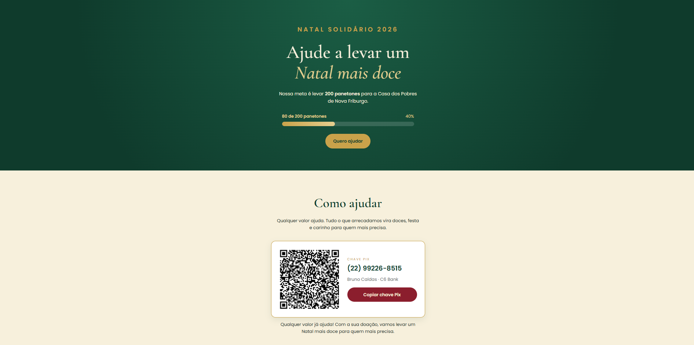
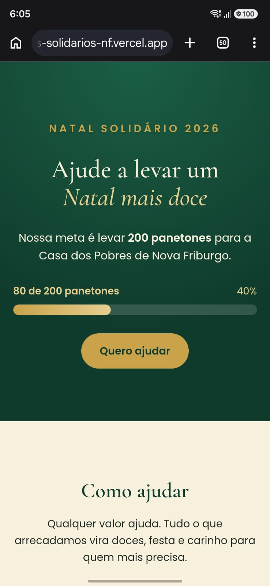

# Corações Solidários

Site oficial do projeto social **Corações Solidários**, um grupo de amigos de Nova Friburgo (RJ) que arrecada doações para levar panetones, ovos de Páscoa e bombons, com festa e carinho, a abrigos e instituições da cidade.

**Site no ar:** https://coracoes-solidarios-nf.vercel.app/

<p align="center">
  
</p>

<p align="center">
  
</p>


## O que tem no site

Landing page de página única, pensada para abrir rápido no celular pelo link da bio do Instagram:

- **Capa e campanha atual**, com termômetro da meta
- **Como ajudar**, com QR Code e botão de copiar a chave Pix
- **Nossa história**, com a linha do tempo das edições (Natal 2024 a Natal 2026)
- **Galeria das edições**, com fotos e vídeos de resumo
- **Patrocinadores**, com logos e links
- **Contato**, com WhatsApp e Instagram

## Tecnologias

- [React](https://react.dev/) + [Vite](https://vite.dev/)
- CSS puro (variáveis em `src/styles/variables.css`)
- Vídeos hospedados no YouTube (carregam só ao clicar)
- Deploy na [Vercel](https://vercel.com/)

## Rodando localmente

Precisa do [Node.js](https://nodejs.org/) em uma versão LTS recente.

```bash
npm install
npm run dev
```

O site abre em `http://localhost:5173`. Para gerar a versão de produção:

```bash
npm run build
```

## Estrutura do projeto

```
public/
├─ images/
│  ├─ edicoes/<id-da-edicao>/   fotos de cada campanha
│  ├─ patrocinadores/           logos dos apoiadores
│  └─ qr-pix.png                QR Code do Pix
├─ og-image.jpg                 imagem de prévia do link (WhatsApp etc.)
└─ favicon.*                    ícones do site

src/
├─ components/                  seções do site (Hero, HowToHelp, Impact, Gallery...)
├─ data/                        conteúdo que muda (campanha, edições, patrocinadores)
├─ styles/                      variáveis e estilos globais
├─ App.jsx
└─ main.jsx
```

## Como atualizar o conteúdo

Quase tudo se altera nos arquivos de `src/data/`, sem mexer nos componentes.

### Termômetro da campanha

Em `src/data/campaign.js`, atualize `reached` com o valor atual:

```js
reached: 120, // quantidade já arrecadada
```

Para uma nova campanha, ajuste também `name`, `goal`, `itemLabel` e `institution`.

### Patrocinadores

1. Coloque a logo em `public/images/patrocinadores/` (o nome do arquivo precisa ser idêntico ao do código, incluindo maiúsculas e a extensão).
2. Adicione uma linha em `src/data/sponsors.js`:

```js
{ name: "Nome da empresa", logo: `${base}/Arquivo.jpg`, url: "https://www.instagram.com/...", ativo: true },
```

Use `ativo: false` para esconder um patrocinador sem apagá-lo. Se a logo ficar pequena no cartão, adicione `zoom: 1.4` (ou outro valor) na linha.

### Edições, fotos e vídeos

Em `src/data/editions.js`:

1. Crie a pasta `public/images/edicoes/<id>/` e coloque as fotos (de preferência `.jpg`, com até uns 200 KB cada).
2. Liste as fotos no campo `fotos` da edição.
3. Para o vídeo, cole o **id** do YouTube em `video` (o trecho final do link, depois de `v=`, de `youtu.be/` ou de `shorts/`). Use `vertical: true` para Shorts.
4. Quando uma campanha terminar, remova `andamento: true` e atualize o texto com o resultado.

### Chave Pix, WhatsApp e links

Ficam em `src/data/site.js`. A mensagem automática dos botões de WhatsApp é definida nos componentes `Contact.jsx` e `Sponsors.jsx`.

## Publicação

O deploy é automático: cada `git push` na branch `main` publica uma nova versão na Vercel.

## Cuidados com imagens

- Os rostos das pessoas atendidas pelas instituições devem sempre ser preservados (borrados ou fora das fotos e vídeos).
- Mantenha as imagens leves para o site carregar bem no celular.
- No Windows, maiúsculas e minúsculas não diferenciam arquivos, mas na Vercel diferenciam: confira os nomes e as extensões.

## Créditos

Desenvolvido por [Kaynan Vieira](https://kaynanvieira.vercel.app/).

© Corações Solidários. Todos os direitos reservados. As logos pertencem aos respectivos patrocinadores.